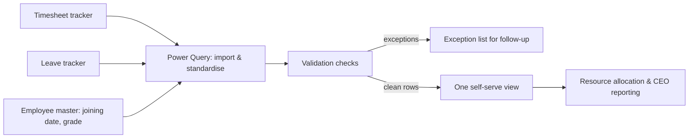

# HR tracker automation: timesheets, leave and end-of-service

**Decision it supports:** who is available, where, and at what cost, so staff can be allocated across concurrent construction projects using current, clean HR data rather than numbers reconciled by hand.

**Result:** separate manual trackers replaced by one refreshable Excel and Power Query view, saving **20–25 hours a month** of manual tracking.

**Context (anonymised):** a Jeddah construction contractor, CEO's office. No employee records, names, salaries or company files are published here. The schema and sample rows below are illustrative only.

## The problem before

- Timesheets, leave and end-of-service (EOS) information sat in separate trackers, each with its own layout and update rhythm.
- Every cycle someone copied, matched and checked them by hand before figures could be used.
- Mismatches (an employee on leave who also appears on a timesheet, a missing joining date for an EOS estimate) were found late, if at all.
- Staffing figures reached project and budget reviews late or with caveats.

## The workflow now



1. **Import:** Power Query reads each tracker as it is kept today, so nobody has to change how they record data.
2. **Standardise:** consistent employee IDs, date formats, project codes and leave types.
3. **Validate:** rule-based checks run on every refresh (see controls).
4. **Separate exceptions:** rows that fail a check go to an exception list with the reason, instead of being silently dropped or fixed.
5. **Publish:** clean rows feed one view showing attendance, leave balances and EOS accruals by project and period.

## Inputs and outputs

| Inputs | Outputs |
|---|---|
| Timesheet tracker (employee, date, project, hours) | Attendance and hours by project and period |
| Leave tracker (employee, leave type, start, end) | Current and upcoming leave, by project |
| Employee master (ID, joining date, grade) | EOS accrual estimate per employee, rolled up |
| | Exception list with a reason for each row |

## Controls

The rules below are simplified and generalised for this write-up.

- Every employee ID in a tracker must exist in the master.
- No timesheet hours on a day the same person is on approved leave.
- Leave end date on or after start date; no overlapping leave records.
- EOS estimate only where a joining date exists; otherwise flagged.
- Row counts and totals reconciled back to each source tracker on refresh before anything is shared.

## Illustrative schema (synthetic, not real data)

```text
fact_timesheet(employee_id, work_date, project_code, hours)
fact_leave(employee_id, leave_type, start_date, end_date, status)
dim_employee(employee_id, joining_date, grade, home_project_code)
exceptions(source, row_ref, employee_id, rule, detail)
```

| employee_id | work_date | project_code | hours |
|---|---|---|---|
| E-001 | 2026-01-04 | PRJ-A | 8 |
| E-002 | 2026-01-04 | PRJ-B | 9 |

## Limitations

- The tool itself and its data stay with the employer; this page describes the design, not a downloadable copy.
- 20–25 hours a month is the manual tracking time removed, as reported in my CV; no formal time study is published here.
- EOS figures in such a view are estimates for planning, not a substitute for payroll or legal calculation under the Saudi Labor Law.
